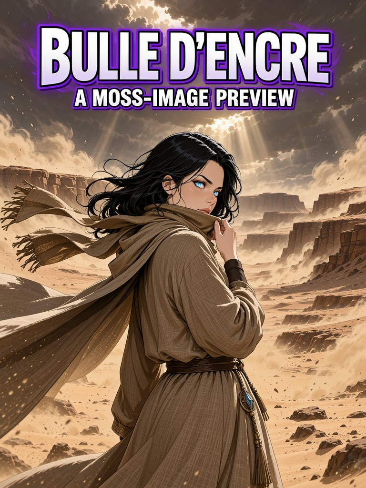
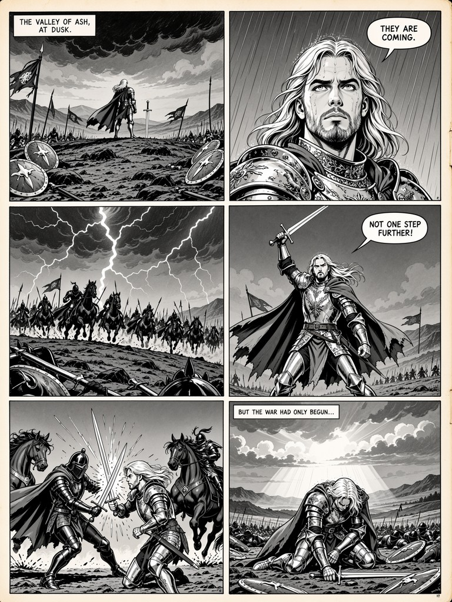
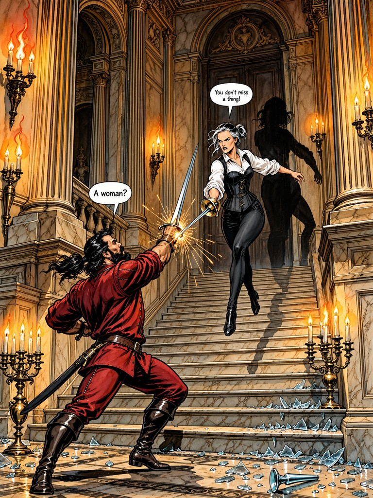
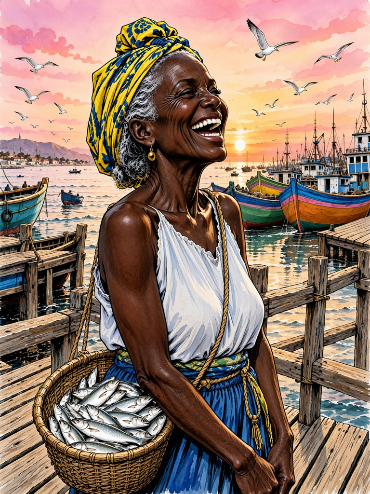
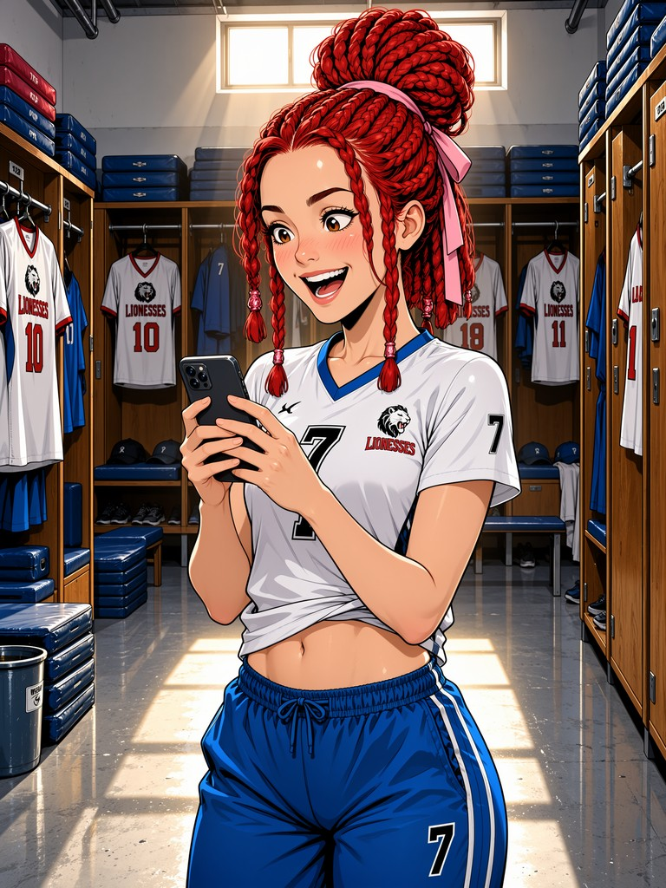
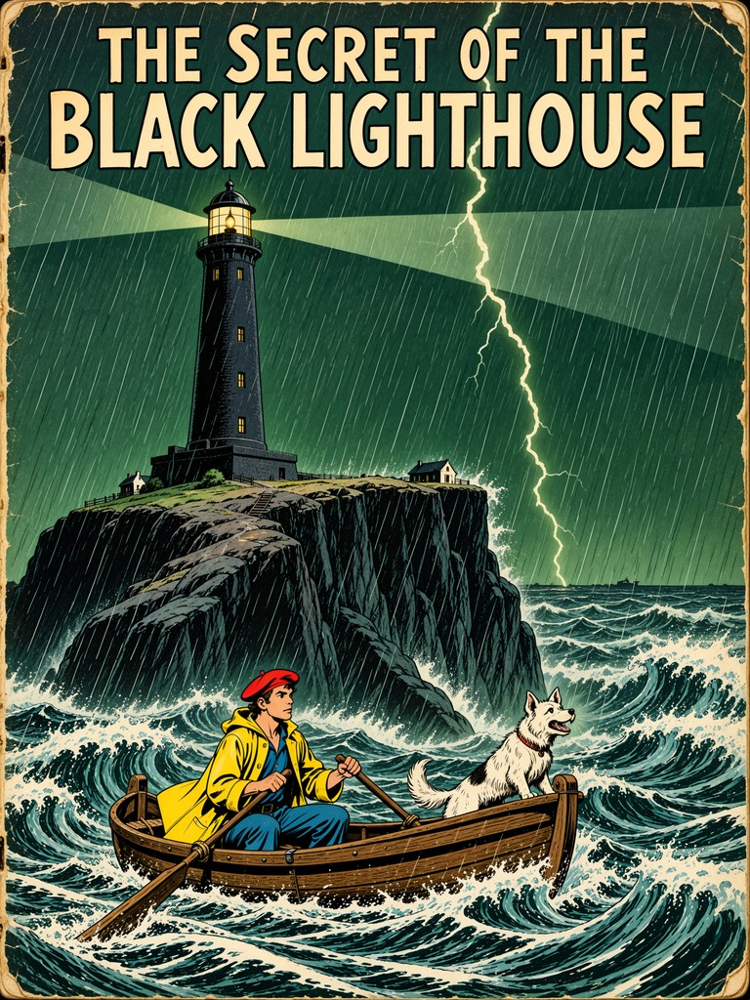

# Bulle d'Encre — a MOSS-Image preview

*Bulle d'encre* is French for "ink speech balloon". It is a single-file MOSS-Image text-to-image checkpoint for ComfyUI with a style of its own: European comic ink and colour with an anime soul, comic pages with panels and speech balloons, and the readable text MOSS-Image is good at.

> **Preview.** Bulle d'Encre is an early look at the tests for a future HaDeS finetune of MOSS-Image. It is a merge of [MOSS-Image-SFT](https://huggingface.co/OpenMOSS-Team/MOSS-Image-SFT) and [MOSS-Image-Base](https://huggingface.co/OpenMOSS-Team/MOSS-Image-Base) with two of the author's LoRAs baked in: a style LoRA trained on the author's own images and the published [HaDeS MOSS Turbo 8-steps v1.0](https://huggingface.co/DeVilDoNia/HaDeS-MOSS-Turbo). The full finetune, with a much larger dataset, is in progress; this file shows where it is heading, not the finished model.

| File | Precision | Size | SHA-256 |
|---|---|---|---|
| `HaDeS_MOSS_preview_beta.safetensors` | BF16 | 10.16 GB (9.47 GiB) | `6eb28847975138ac75cf99ff6c77fbeae6ea614266e76409035c9aaf7fdd2e9d` |
| `HaDeS_MOSS_preview_beta_int8_convrot.safetensors` | int8 ConvRot | 5.41 GB (5.04 GiB) | `121b0bd309c8f2a678d13b176c4b226d24edba38532f51d7771f9bdd5dcbe3e6` |

The int8 file is the BF16 one converted, with no other change (see [int8 version](#int8-version)).

This is **only the diffusion model**; it does not contain the MOSS text encoder or VAE. **No separate Turbo or other LoRA is needed** to run it. The file keeps its working name, `HaDeS_MOSS_preview_beta`, so the workflows embedded in the sample PNGs load it as they are; it is the file the samples were made with (their metadata carry the same model hash, `6eb2884797`).

## Sample images

Display-size JPEGs (768 × 1024) of the author's outputs at 1344 × 1792 with the settings below, all with **the same seed, 1200**, on purpose: they show what the prompt alone achieves, without picking seeds. The prompts are long natural-language descriptions written with the [HaDeS MOSS Suite](https://github.com/Devildonia/HaDeS-MOSS-Suite) Prompt Enhancer and refined over a few rounds of corrections (see [How the prompts were made](#how-the-prompts-were-made)); the full prompts, negative prompts and settings are in [`assets/manifest.json`](assets/manifest.json). These examples show individual outcomes, not a measured success rate.

| Cover with title | 1950s black-and-white page | Staircase duel |
|---|---|---|
|  |  |  |

| Portrait | Text on every shirt | Album cover |
|---|---|---|
|  |  |  |

Plain Danbooru-style tag prompts work too, if that is what you are used to from Illustrious or NoobAI models; a few tag-prompted examples are in the Civitai gallery.

## Use in ComfyUI

1. Put the `.safetensors` file in `ComfyUI/models/diffusion_models/` and load it with **Load Diffusion Model** (or the Suite's `MOSS Loader`).
2. Load the `qwen3.5_9b_int8_convrot.safetensors` text encoder (Load CLIP, type `moss_image`) and the `flux2-vae.safetensors` VAE from [Comfy-Org/MOSS-Image](https://huggingface.co/Comfy-Org/MOSS-Image).
3. Sample from an empty latent with these settings:

| Setting | Recommended (used for the samples) |
|---|---|
| Size | 1344 × 1792 |
| Steps | 15 |
| CFG | 2.5 (the cover: 3); the author has used up to 5 |
| Sampler / scheduler | Euler / sgm_uniform |
| Flow shift | 5 |
| Skip-layer guidance | Off |
| Negative prompt | `worst quality, bad anatomy, jpeg artifact, colorful` |

CFG 2.5 is the recommended value; the author has also used it up to 5 (his impression, not measured). The strength tests below used Euler / simple; the samples used sgm_uniform. **Not measured on this model:** other step counts, CFG values or sizes.

### Why the Turbo is baked in at 0.5, and why not to add more

The Turbo LoRA is here at **half strength** to let the model run at 15 steps without changing its style: the aim is the image the style LoRA gives at 25 steps without any Turbo, in fewer steps.

- **Measured** on the style LoRA before this merge (Base + style LoRA, distance to the 25-step, no-Turbo image, in units of the distance between two seeds; lower is closer): at 15 steps, no Turbo gives 0.35-0.45; Turbo at 0.25 gives 0.28. Low Turbo strengths bring 15 steps closer to the 25-step style, not further from it. Strengths above 0.35 were not part of that measurement.
- **The author's tests** (not measured): at 0.5 the Turbo fixes hands and poses while the image stays almost the same as without it. At full strength (1.0) it changes the style: images from different style checkpoints drift toward the same look.

For the style as shown here, use the file without a separate Turbo at 15 steps.

**Faster option:** load the [Turbo 8-steps v1.0](https://huggingface.co/DeVilDoNia/HaDeS-MOSS-Turbo) on top at **0.5** (with the 0.5 already in the file, that is the full Turbo) and sample at **4-8 steps**. The author has tested it and it works, with some loss of quality in his opinion (not measured).

## Construction

1. **SFT × Base merge:** MOSS-Image-SFT with 30 % of MOSS-Image-Base in the 6 blocks 24-29 only (the Suite's MOSS Model Block Merger); every other block, the text embedder, the modulation and the input / output layers are SFT.
2. **LoRAs**, then saved in BF16 with the Suite's MOSS Model Saver. The recipe is written in the file header (`hades/recipe`).

| LoRA | Strength | Notes |
|---|---:|---|
| [HaDeS MOSS Turbo 8-steps v1.0](https://huggingface.co/DeVilDoNia/HaDeS-MOSS-Turbo) | 0.50 | The author's published DMD LoRA, trained on Base. At half strength it is used here for its look, at 15 steps and CFG 2.5. |
| HaDeS mega style LoRA (checkpoint 5250) | 0.80 | The author's style LoRA, not published separately: trained on Base on 1200 images the author generated in Forge with his own models (some of them unreleased), captioned with their original tag prompts. |

**Why 0.80 for the style LoRA:** strengths 0, 0.5, 0.6, 0.7, 0.8, 0.9 and 1.0 on nine two-character action prompts, two seeds each. The LoRA's effect saturates early: measured as the CLIP-ViT-H distance of each image to the same prompt and seed without the LoRA, 0.7 already gives 89 % of the change at 1.0, and 0.8 gives 95 %. By eye, the failures that grow with strength (a character cloned, poses turning frontal and symmetric) start at 0.8 and grow at 0.9-1.0. The author chose 0.8 for its style.

**Why SFT × Base:** against the same two LoRAs on Base alone, the merge kept more of the prompt in the author's tests (one seed per scene, judged by eye): objects stayed as asked, extra copies of a character were fewer, and named ethnicities came out closer to the description, with the same style.

**Baked against live:** a file can match the LoRAs applied live in ComfyUI only weight for weight; at 15 steps a difference of one rounding step is enough to change small details. Against the same LoRAs loaded live (two prompts, same seed), this file gives the same compositions, characters and light, with small details changed.

## int8 version

`HaDeS_MOSS_preview_beta_int8_convrot.safetensors` is the BF16 file saved by the Suite's MOSS Model Saver in the layout of Comfy-Org's `*_int8_convrot` files: the linear layers of the 42 blocks in int8 with ConvRot (Hadamard rotation) and int8 attention, everything else in BF16. Load it the same way, with the same settings; it needs a ComfyUI recent enough to load those files.

Against the BF16 file on the six sample prompts (seed 1200, 1344 × 1792, 15 steps, Euler / sgm_uniform, the samples' CFG and negative prompt):
- Same compositions in all 6. Mean absolute difference on a 64 px thumbnail: 3.9 % (2.1-6.7 %). Small details change: a pose shifts a little in the duel, the numbers on the shirts in the background of the locker room differ.
- The titles and balloons read the same: "BULLE D'ENCRE", "THE SECRET OF THE BLACK LIGHTHOUSE", the knight page's captions and balloons, "A woman?" / "You don't miss a thing!".
- Sharpness about the same: mean Laplacian variance 2123 against 2054 for BF16.
- The BF16 renders of this test were pixel-identical to the author's sample PNGs, so the samples can be reproduced from their metadata.

Speed was not measured as a benchmark for this card.

## How the prompts were made

The samples follow one workflow with the Suite's Prompt Enhancer: write the idea (or paste a tag prompt), let the `detailed` mode expand it, generate, then paste the prompt back with notes after the label `Correcciones:` / "Corrections:" and generate again, one correction at a time. Things that helped on this model, seen in the author's tests (not measured):

- **Two characters:** give each a place in the frame (`in the lower foreground`, `descending from above`) and name the point of contact (`his cutlass clashing against her rapier`, `his hand grasps her wrist`). Give a second figure clearly different features, or it may come out as a copy of the first.
- **Text:** write the exact words, in quotes or as `the text ...`. One balloon per line, and say whose balloon it is and where: `next to the thief's head, its tail pointing to his mouth`.
- **Camera angles** are followed when written as a full sentence (`The perspective is an extreme low-angle worm's-eye view looking straight up ...`); a short tag such as `low angle` is often ignored.
- **Describe what is there, not what is missing:** negations (`riderless`, `no color`) tend to add what they name. Metaphors are drawn literally (`fruit scattering like jewels` drew jewels).

## Known limits

- **Two characters interacting** (pulling, fighting, holding each other) can need a few prompt corrections or other seeds. The samples all use one seed, which made some scenes harder; in the strength test above, some interactions were lost on both seeds.
- **Short camera-angle tags** are often ignored; see above.
- **Unrequested brand logos** can appear on common objects (a coffee-shop logo on takeaway cups, a car maker's badge on a bus grille). Describe the object plainly (`plain white takeaway cups`) and check images before you publish them.
- Now and then a fake signature, an extra copy of an object, or invented small text (signs, kanji) in the background.
- The style LoRA's images included mature content, so the model can produce it when asked.

## Credits and license

Built on [OpenMOSS-Team/MOSS-Image-SFT](https://huggingface.co/OpenMOSS-Team/MOSS-Image-SFT) and [OpenMOSS-Team/MOSS-Image-Base](https://huggingface.co/OpenMOSS-Team/MOSS-Image-Base), released under [Apache 2.0](https://huggingface.co/OpenMOSS-Team/MOSS-Image-Base/blob/main/LICENSE). The two LoRAs are the author's own. This checkpoint is released under Apache 2.0. ComfyUI tooling: [HaDeS MOSS Suite](https://github.com/Devildonia/HaDeS-MOSS-Suite).
