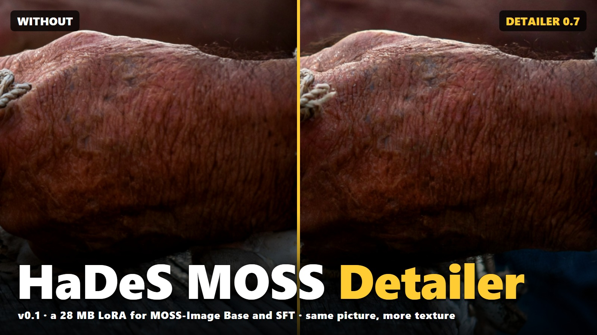
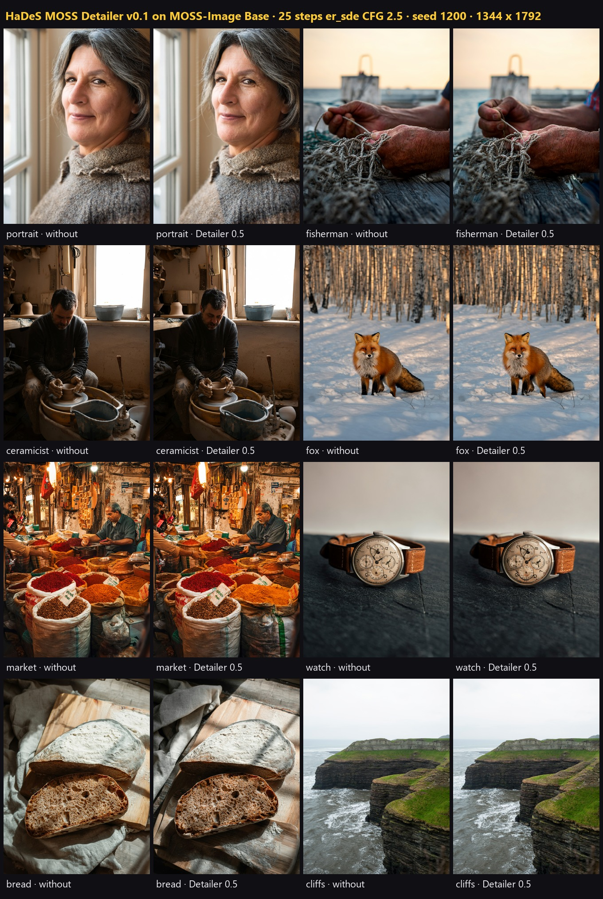
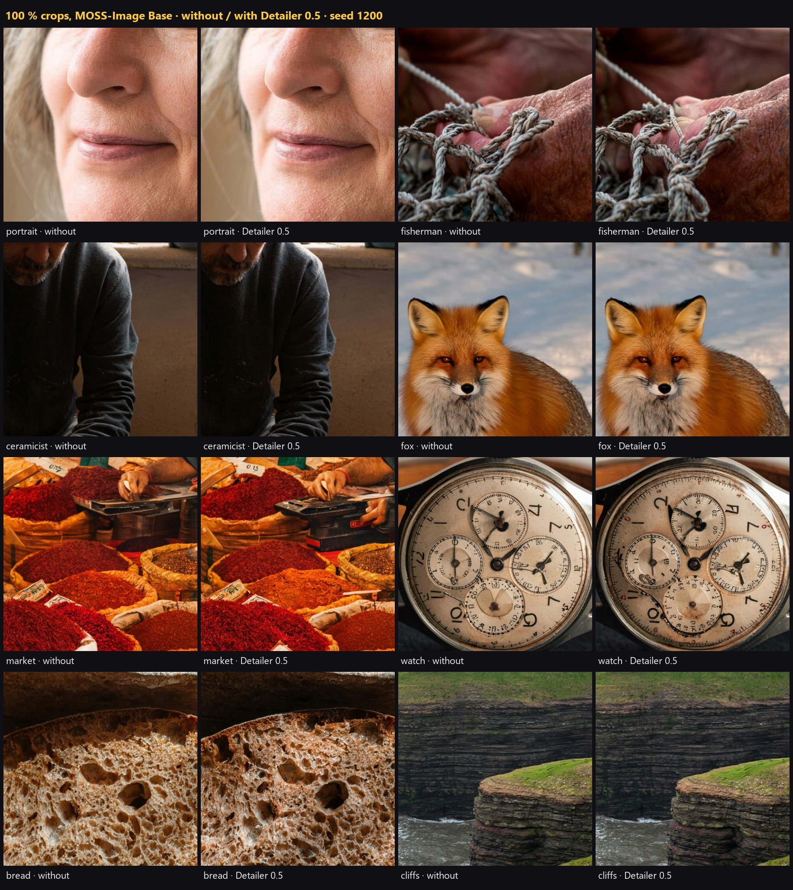
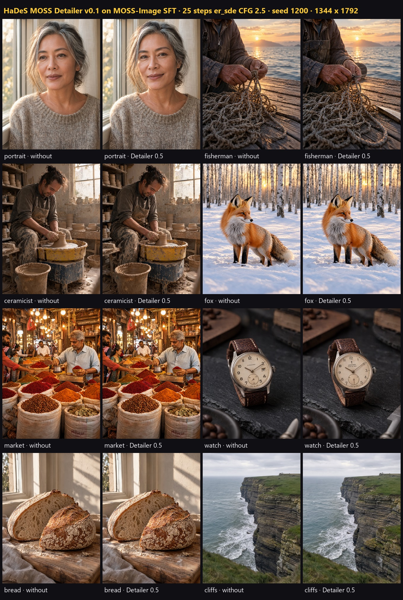
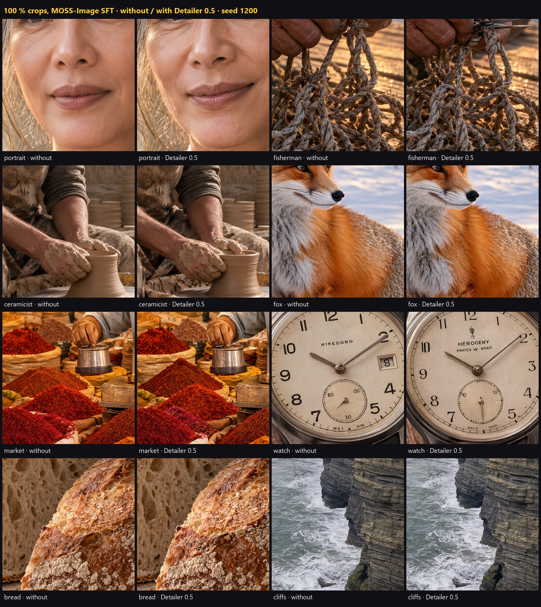
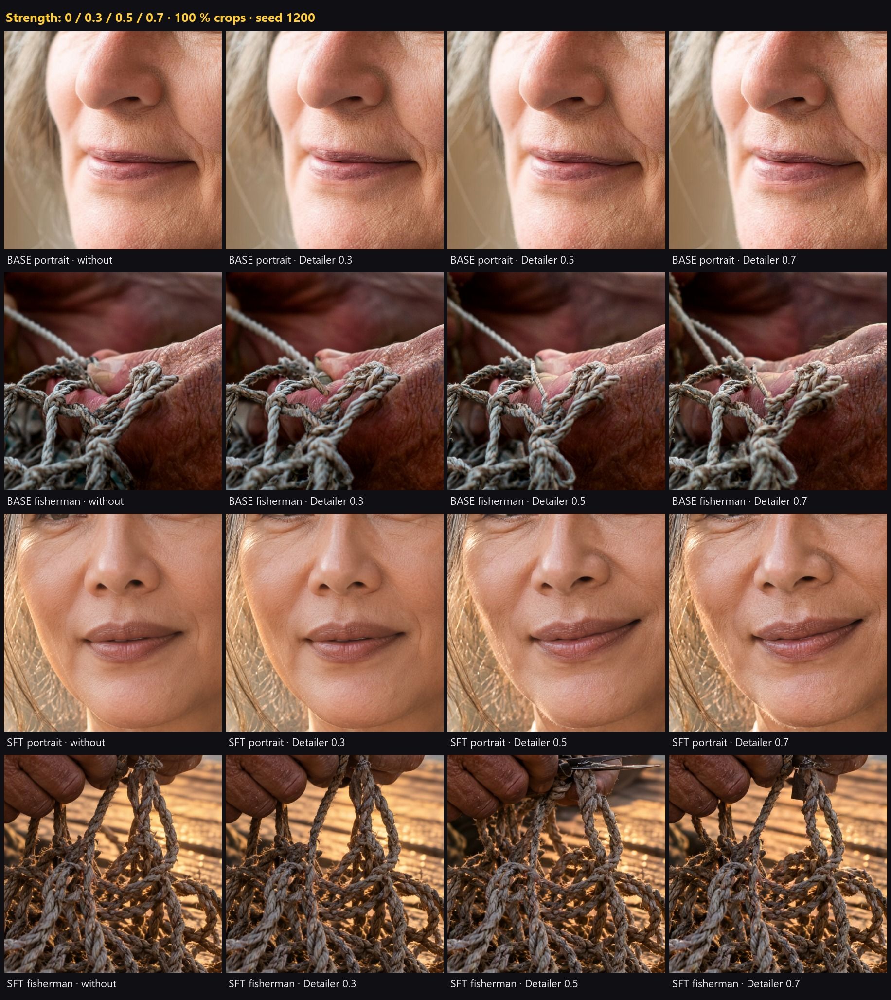

# HaDeS MOSS Detailer v0.1

A small LoRA (28 MB) for **MOSS-Image Base** and **MOSS-Image SFT** that adds fine detail and texture (skin pores and lines, fabric,
rope fibres, fur, stone) while keeping the picture: same composition, same colours. Load it on top of your usual settings at a strength
of **0.3 to 0.7**.

| File | Size | SHA256 |
|---|---|---|
| `HaDeS-MOSS-Detailer-v0.1.safetensors` | 28.3 MB (rank 16, layers 24–41, fp16) | `75e08b5e17edb19bdc9ec8f4a356d8e366408b36637eb751865b61bfeb44a47d` |

## Use

- **Models:** MOSS-Image Base or SFT (`moss_image_base_bf16` / `moss_image_sft_bf16` from
  [Comfy-Org/MOSS-Image](https://huggingface.co/Comfy-Org/MOSS-Image)), the Qwen3.5-9B text encoder (`moss_image` type) and the FLUX.2 VAE.
- **Strength:** 0.3 for a light touch, 0.5 as a default, 0.7 for clearly more texture.
- **Settings measured:** 25 steps, CFG 2.5, `er_sde / simple`, shift 5.0. Other samplers and step counts run but were not measured.
- **ComfyUI, stock nodes:** `LoraLoaderModelOnly` on the model, then `KSampler`. A ready workflow with only core nodes comes with the
  Civitai upload.
- **ComfyUI, HaDeS MOSS Suite:** the Suite's LoRA loaders, or the same `LoraLoaderModelOnly` in front of `MOSS KSampler`.
- **With a turbo LoRA** (8 steps, CFG 1), it does little: about 3 % more sharpness at 0.5. It is made for full-step renders.

## Measured

Each image with the Detailer is compared with the same model, prompt and seed without it. Sharpness is the spread of the image's
Laplacian (fine edges) as a ratio; MAE is the mean pixel change at 512 px (0–255). As a scale for MAE: MOSS-Image Base at 25 and at
50 steps differs by 10.5 on the same prompts. Full tables and scripts:
[`tools/RESULTS.md`](https://github.com/Devildonia/HaDeS-MOSS-Suite/blob/main/tools/RESULTS.md), section "PCM pilot, Turbo + PCM recipes
and HaDeS MOSS Detailer v0.1".

| Set | Model | Strength | Change (MAE) | Sharpness | Saturation |
|---|---|---:|---:|---:|---:|
| 12 prompts, seed 1001, 1024 × 1024 | Base | 0.3 / 0.5 / 0.7 | 4.4 / 5.2 / 7.2 | ×1.05 / ×1.10 / ×1.21 | ×0.99 / ×0.99 / ×1.01 |
| | SFT | 0.3 / 0.5 / 0.7 | 4.4 / 6.3 / 8.1 | ×1.02 / ×1.06 / ×1.11 | ×0.99 / ×1.01 / ×1.01 |
| 8 scenes on this card, seed 1200, 1344 × 1792 | Base | 0.5 | 6.3 | ×1.08 | ×1.01 |
| | SFT | 0.5 | 6.7 | ×1.11 | ×1.01 |

- **The picture stays.** The change is below what Base itself changes between 25 and 50 steps. Saturation stays within about 1 % on
  both sets; on the two strength-ladder scenes Base came out 5–8 % more saturated at 0.3–0.7.
- **It adds texture, it does not restyle.** SFT keeps its own look: it is sharper and more saturated than Base to begin with, and the
  Detailer adds detail on top without moving its colours toward Base's.
- **Small things can change.** It is a LoRA on the model, not a filter on the image: in SFT's fisherman a pair of scissors appeared at
  0.5, and an invented watch brand and date window changed. One scene moved more on Base (the bread: MAE 23.4, a little less saturated).

### Base, without / with Detailer 0.5

### SFT, without / with Detailer 0.5

### Strength 0 / 0.3 / 0.5 / 0.7

On these two scenes, at 0.3 / 0.7: Base sharpness ×0.98 / ×1.12 (saturation ×1.05 / ×1.08), SFT ×1.03 / ×1.18 (×1.00 / ×1.00).

**Not measured:** other samplers and step counts, sizes above 1344 × 1792, finetunes and merges, img2img, editing, MOSS Control.

## How it was made

The Detailer is the first checkpoint of a phased consistency (PCM) training, a pilot for a turbo that keeps real CFG and stays close
to Base's own image. Used alone at full steps it turned out to add texture without changing the picture, so it is published for that.

- `tools/moss_pcm_train.py` in the HaDeS MOSS Suite: phased consistency (PCD* variant) adapted to flow matching. MOSS-Image Base as
  teacher and student, 8 phases taken from the stock euler / simple 8-step schedule, the teacher's step without CFG and a 10 %
  condition drop, so real CFG still works.
- LoRA rank 16 on layers 24–41, lr 2e-5, batch 16, 512 px, on 2,048 images Base rendered at 25 steps (from the Turbo v2.0 training
  run). This file is update 1,000 (4.3 s per update on one RTX 5090); later checkpoints were not better.
- Saved in fp16. ComfyUI on this GPU applies LoRAs in fp16, so the fp32 training export gives the same computation.

## Credits and license

Apache License 2.0. Trained from MOSS-Image Base by the OpenMOSS Team (Apache 2.0); also tested on MOSS-Image SFT (Apache 2.0).
The method follows Phased Consistency Models (Wang et al., 2024, arXiv 2405.18407); none of its weights were used.
ComfyUI tooling: [HaDeS MOSS Suite](https://github.com/Devildonia/HaDeS-MOSS-Suite).
