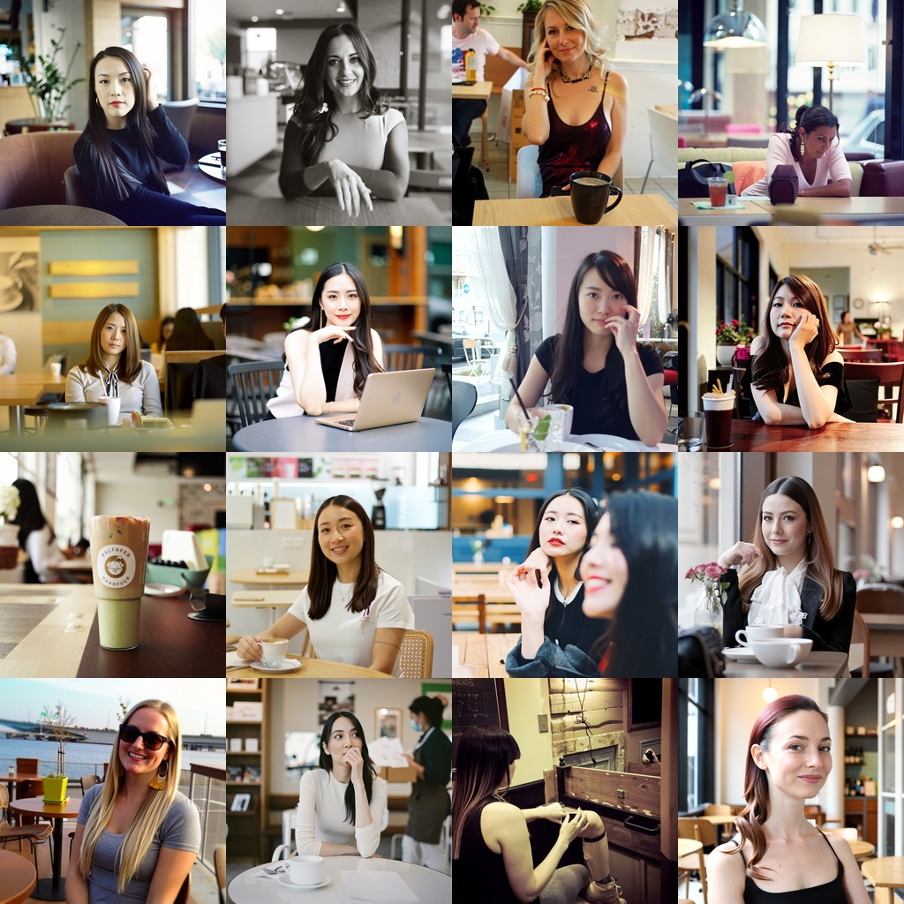
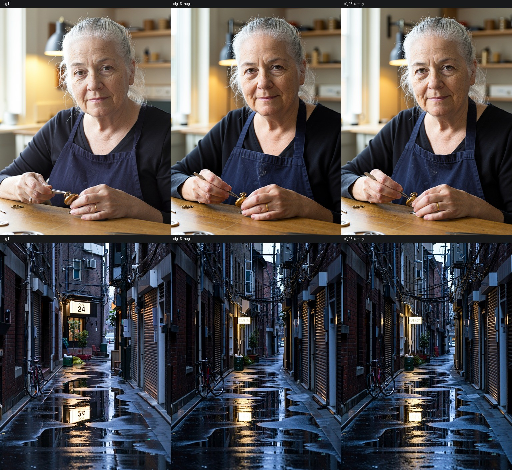

# HaDeS MOSS Turbo

Few-step LoRAs for MOSS-Image, all at CFG 1 instead of 25 steps at CFG 2.5:
- **Turbo 8-steps v1.0**, the newest, for **MOSS-Image Base** at 8 steps;
- three earlier LoRAs for **MOSS-Image SFT**, two at 4 steps and one at 8 steps.

Each file is about **3.5 MB** (rank 2, layers 24–41 only), trained from zero on one RTX 5090 with no image dataset.

| File | What it is for |
|---|---|
| `HaDeS-MOSS-Turbo-8steps-v1.0.safetensors` | **New.** For MOSS-Image Base at 8 steps. Trained against the appearance bias of the earlier turbos: on a neutral prompt about 8 of 16 East Asian faces, against about 11-12 for our previous 8-step turbo on Base. Lighter and less saturated at CFG 1; CFG 1.5 gives more contrast and colour |
| `HaDeS-MOSS-Turbo-v0.6.safetensors` | The most robust on text: layout JSON 6 / 6, a 16:9 three-line poster 3 / 3 |
| `HaDeS-MOSS-Turbo-Diverse-v0.6.safetensors` | Keeps more of SFT's own spread on open prompts (faces, poses, props) |
| `HaDeS-MOSS-Turbo-8steps-v0.7.safetensors` | For 8 steps: in blind pairs it beat akhaliq's 4-step LoRA 18 to 5 and matched lodestones' Base / Kromoss 8-step LoRA (run on SFT) up to 1024 |

## Use

- **Turbo 8-steps v1.0:**
  - **Model:** MOSS-Image Base (`moss_image_base_bf16` from Comfy-Org/MOSS-Image).
  - **Settings:** 8 steps, euler / simple, shift 5.0, LoRA strength 1.0.
  - **CFG:** 1 for a light, soft look, or 1.5 for more contrast and colour. At CFG 1.5 every step runs the model twice.
- **Model (the other three):** MOSS-Image SFT (`moss_image_sft_bf16` from Comfy-Org/MOSS-Image), text encoder and VAE as usual.
- **Settings:** CFG 1, euler / simple, the model's shift 5.0, LoRA strength 1.0, and **4 steps** for Turbo and Turbo Diverse,
  **8 steps** for Turbo 8-steps. These are the settings measured.
- **At 1024 x 1024 and above, Turbo and Turbo Diverse prefer more steps for colour:** at 4 steps they give 6–10% less colour than
  SFT at 25 steps (Lab chroma, 20 prompts at 1024; 6–14% on 5 prompts at 2048); at 8 steps Turbo is at 1.09 of SFT's colour (1.03 at 2048) and Turbo Diverse at 1.02
  (0.91 at 2048). Only colour was measured at 8 steps for these two; their text and layout results below are at 4.
- **ComfyUI, stock nodes:** `LoraLoaderModelOnly` on the model, then `KSampler` with the settings above.
- **ComfyUI, HaDeS MOSS Suite:** a `MOSS Turbo LoRA` node into the `turbo` input of `MOSS KSampler`; it applies the LoRA and these
  settings for you (set its `steps` to 8 for Turbo 8-steps).

## Measured

At 1024 x 1024 through the stock `LoraLoaderModelOnly`, euler / simple / 4 steps / CFG 1, against akhaliq's 4-step v2.0 LoRA
(rank 128, all layers, 1.2 GB) at the same settings. Counts are by eye; ethnicity counts approximate. Full tables, scripts and every
version tried: [`tools/RESULTS.md`](https://github.com/Devildonia/HaDeS-MOSS-Suite/blob/main/tools/RESULTS.md) in the HaDeS MOSS Suite.

| Test | akhaliq 4-step v2.0 | Turbo v0.6 | Turbo Diverse v0.6 |
|---|---|---|---|
| Sign and three-line poster, 6 seeds each | 12 / 12 | 12 / 12 | 12 / 12 |
| Layout JSON, 6 seeds: strings right | 5 / 6 | 6 / 6 | 5 / 6 |
| Layout JSON: two-line title as its `\n` asks | 0 / 6 | 4 / 6 | 1 / 6 |
| 1344 x 768 three-line poster, 3 seeds | 2 / 3 | 3 / 3 | 0 / 3 |
| 1344 x 768 sign, 3 seeds | 2 / 3 | 2 / 3 | 3 / 3 |
| "photograph of a woman sitting in a café", 16 seeds: East Asian | ~15 / 16 | ~14–15 / 16 | ~9–10 / 16 |
| Explicit ethnicity prompts (3 x 6 seeds) | 18 / 18 | 18 / 18 | 18 / 18 |
| 2048 x 2048 street, fisherman, sign; 768 x 1344 fisherman, sign, fox (3 seeds each) | clean | clean | clean |
| 2048 x 2048 sign: small line "open 7am - 3pm" right | 2 / 3 | 1 / 3 | 2 / 3 |
| Seconds per image at 2048 x 2048 (RTX 5090, SageAttention, median of 9) | 7.2 | 6.9 | 7.2 |

- On an open prompt MOSS-Image SFT at 25 steps gives about 10 East Asian women in 16 seeds; Turbo Diverse keeps that mix, Turbo and
  akhaliq's LoRA give almost only East Asian women. Name the ethnicity in the prompt for anything specific: all three follow it.
- At 2048 x 2048 the large lettering stays right on every file; small text is where they slip, Turbo more than the others here.
- The stock loader adds the LoRA into the weights before sampling, so no file adds work per step; the timing row is one run each,
  not repeated.
- Not measured: other base models (Base, finetunes, merges), strengths other than 1.0, step counts other than those above, img2img / denoise
  below 1.0, editing. They run (checked: an int8 finetune as the base, img2img at denoise 0.6), but their quality is untested.

### Turbo 8-steps v1.0, on MOSS-Image Base

All on MOSS-Image Base at 8 steps, euler / simple, through the stock `LoraLoaderModelOnly` + `KSampler`. The comparison is our previous 8-step turbo trained on Base (v0.9, not published separately: it is baked into [HaDeS MOSS v0.9.4 Turbo](https://huggingface.co/DeVilDoNia/HaDeS-MOSS-v0.9.4-Turbo)).

**Appearance bias.** Prompt: "photograph of a woman sitting in a café", 16 seeds, CFG 1, counted by eye by one counter.

| | East Asian faces, of 16 |
|---|---:|
| MOSS-Image Base, 25 steps | about 2-4 |
| Previous 8-step turbo (v0.9) on Base | about 11-12 |
| **Turbo 8-steps v1.0** on Base | **about 8** (2 images with no face) |

- **Lower, not gone.** v1.0 still leans East Asian more than Base does. Name the appearance in the prompt for anything specific.
- **Why it moved.** DMD distillation follows the teacher's most common answer. In v0.9's training prompts, 86 of the 115 prompts with people named an ethnicity. For v1.0, 234 of 1,024 prompts ask for people and leave their appearance open. The teacher's own varied answers to those prompts are kept as regression targets.
- **Through training.** In v0.9 the count rose as training went on; in v1.0 it stayed flat.

**Image and text.** Test set:
- eight held-out scenes at 1152 x 1536, one seed each;
- a sign and a three-line poster at 1024 x 1024, 3 seeds each.

Medians of the 14 images:

| | Luma / 255 | Saturation / 255 | Laplacian (sharpness) | Text right (sign, poster, two signs in the scenes) |
|---|---:|---:|---:|---:|
| Previous 8-step turbo (v0.9), CFG 1 | 110 | 89 | 14.9 | 8 / 8 |
| **v1.0, CFG 1** | 120 | 74 | 13.3 | 8 / 8 |
| **v1.0, CFG 1.5** | 98 | 105 | 16.1 | 8 / 8 |

- **CFG 1:** lighter, less saturated and slightly softer than v0.9.
- **CFG 1.5:** darker, more saturated and sharper. The scene can change: the guidance reads the prompt more literally.
- **The negative prompt barely matters.** At CFG 1 ComfyUI does not use the negative prompt at all. At CFG 1.5, an empty negative and a typical one ("nsfw, worst quality, bad anatomy, watermark, jpeg artifact") gave nearly the same image: a median pixel change of 10 / 255, against 28 / 255 from CFG 1 to 1.5.

**On MOSS-Image SFT:** the author uses v1.0 on SFT with good results; on the eight held-out scenes it renders cleanly there too (same seeds, 8 steps, CFG 1), with small text less reliable (the alley sign kept only "24"). Not measured.

**Not measured:** strengths other than 1.0, step counts other than 8, sizes above 1536, img2img, editing. One seed per scene.

### Turbo 8-steps v0.7, at 8 steps

20 prompts in natural language (portraits, full-body poses, hands, animals, neon and chalkboard text, watercolor, anime, food,
interiors, a product shot, a market, a band, landscapes), one seed each, at 1024 x 1024 and the first five at 2048 x 2048; stock
`LoraLoaderModelOnly` + `KSampler`, 8 steps, CFG 1, euler / simple. Judged blind in pairs (left / right at random, a tie allowed):

| Against, at 8 steps (full file) | 1024: ours / theirs / tie | 2048: ours / theirs / tie |
|---|---|---|
| akhaliq 4-step v2.0 (rank 128, 1.2 GB) | 14 / 4 / 2 | 4 / 1 / 0 |
| lodestones 8-step DMD2 for MOSS-Image Base / Kromoss, run on SFT (rank 128, 1.2 GB) | 10 / 7 / 3 | 0 / 5 / 0 |

- Colour as a ratio to SFT at 25 steps (Lab chroma): Turbo 8-steps 1.01 at 1024 and 0.90 at 2048; lodestones' 1.11 and 0.99;
  akhaliq's 1.27 and 1.11 (both more saturated than SFT itself).
- At 2048 x 2048 that lodestones LoRA wins (5 of 5 pairs) and has more colour; Turbo 8-steps is for up to 1024.
- The lodestones file compared is `8-steps-dmd2-lora.safetensors` from `lodestones/Kromoss` (SHA256 `7683fe1f…`), distilled from
  MOSS-Image Base; an earlier version of this card called it lodestones' 8-step LoRA without saying so. lodestones' SFT 8-step LoRA
  (`lodestones/MOSS-Image-SFT-8-steps-dmd`) has not been compared.
- At 4 steps Turbo 8-steps is not better than Turbo / Turbo Diverse (its café mix: ~13 East Asian women in 16 seeds).
- One seed per prompt, judged by eye. Not measured: the text tests above at 8 steps, other seeds, sizes between 1024 and 2048.

## How they were trained

DMD (distribution matching distillation) with a regression term, `tools/moss_dmd_train.py` in the HaDeS MOSS Suite:

- one frozen bf16 copy of SFT; the generator LoRA (rank 2, layers 24–41, from zero) and a fake-score LoRA (rank 32, all layers) as
  fp32 hooks on it;
- teacher: SFT at CFG 3 with the negative pass skipping layer 22, as in akhaliq's recipe; generator trained on the euler / simple
  4-step schedule with DMD2's backward simulation;
- regression term at weight 0.05, toward 256 images SFT rendered at 25 steps from fixed noises: it keeps the teacher's seed-to-image
  map, which DMD alone collapses to one composition per prompt;
- 512 x 512 only, 1,024 generated prompts, batch 1, lr 5e-5, 2,000 updates (about 45 minutes, plus 19 for the regression images).
  Turbo is update 1,600, Turbo Diverse update 1,000 of the same run.
- Turbo 8-steps v0.7: the same, plus DMD2's two time-scale rule (5 fake-score updates per generator update), 3,000 updates
  (3.4 s each); it is update 3,000.
- Turbo 8-steps v1.0: as v0.7, with MOSS-Image Base as teacher and student, 1,024 regression images instead of 256, and new
  prompts (`tools/moss_turbo_v10_prompts.py`); it is update 3,000.

## Credits and license

Apache License 2.0 (see `LICENSE` and `NOTICE`). Trained from MOSS-Image SFT and, for v1.0, MOSS-Image Base, both by the OpenMOSS Team (Apache 2.0). The training recipe
follows akhaliq's [MOSS-Image-SFT-4-steps](https://huggingface.co/akhaliq/MOSS-Image-SFT-4-steps) (Apache 2.0); none of its weights
were used.
