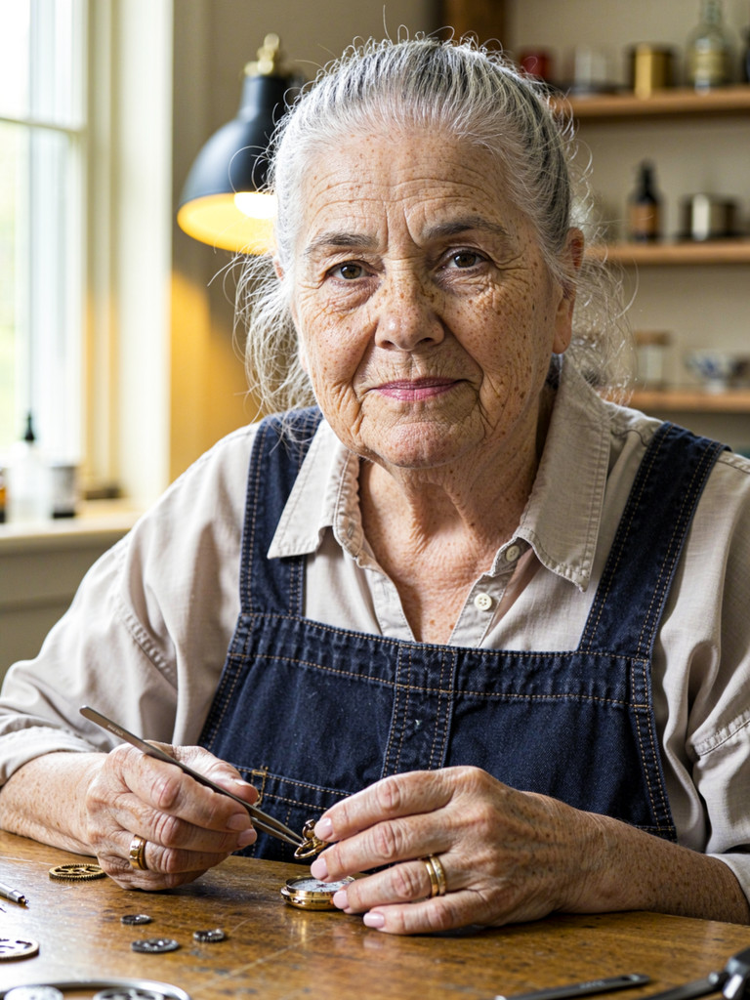
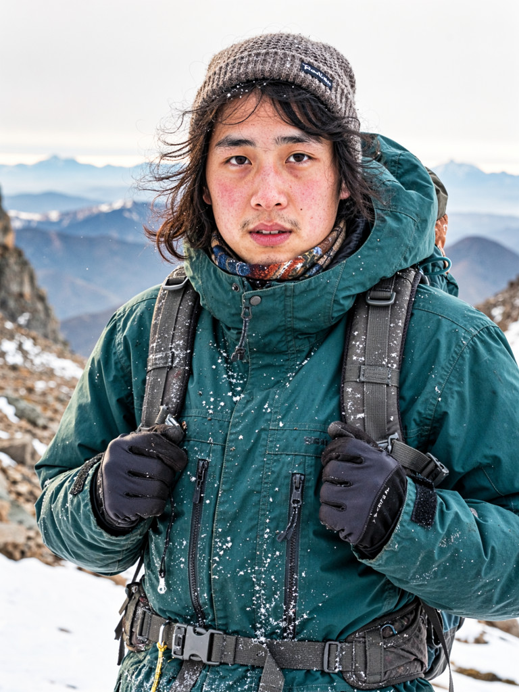
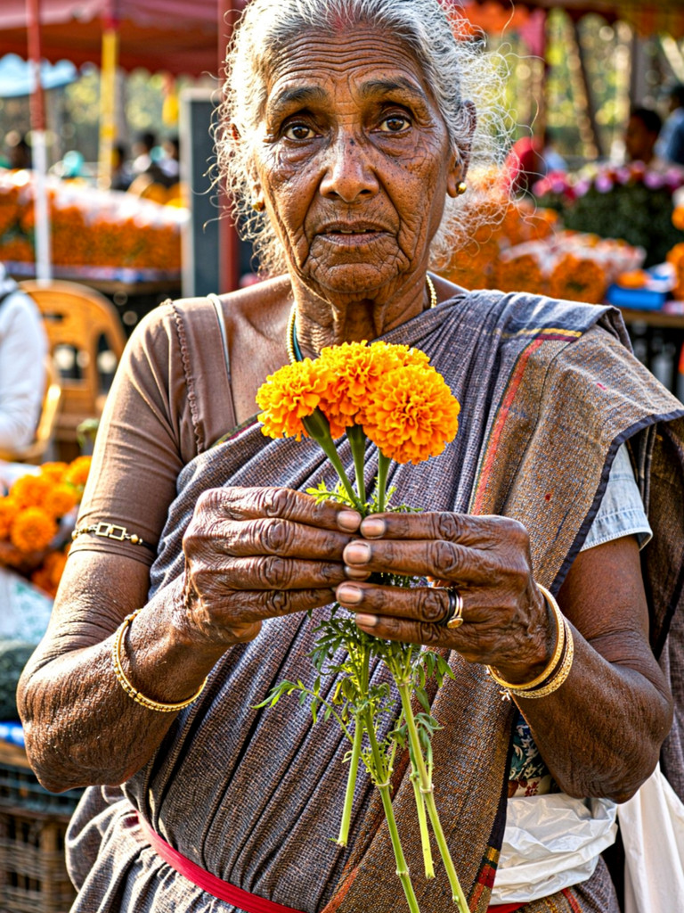
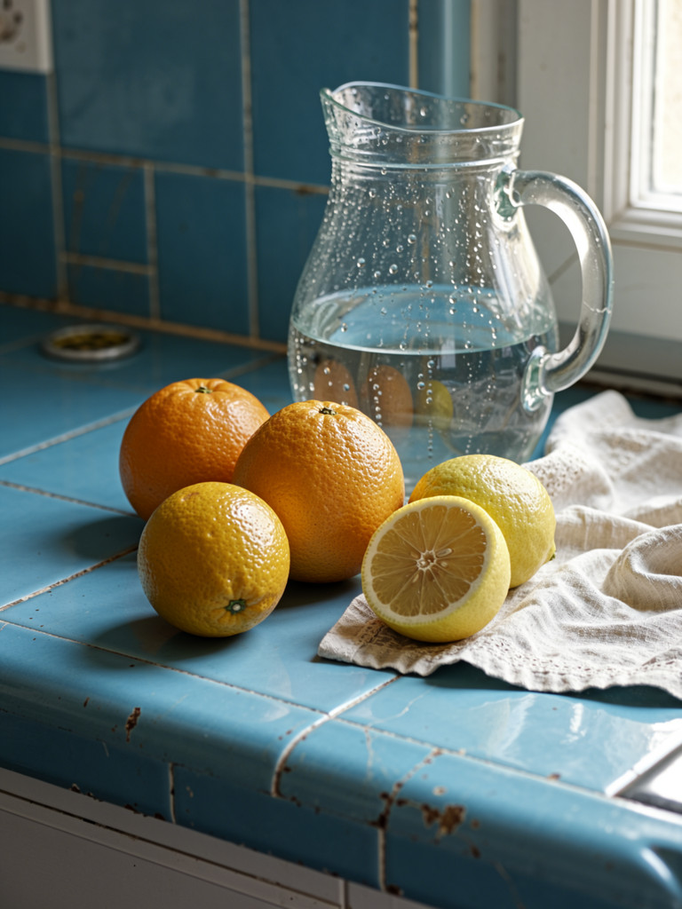
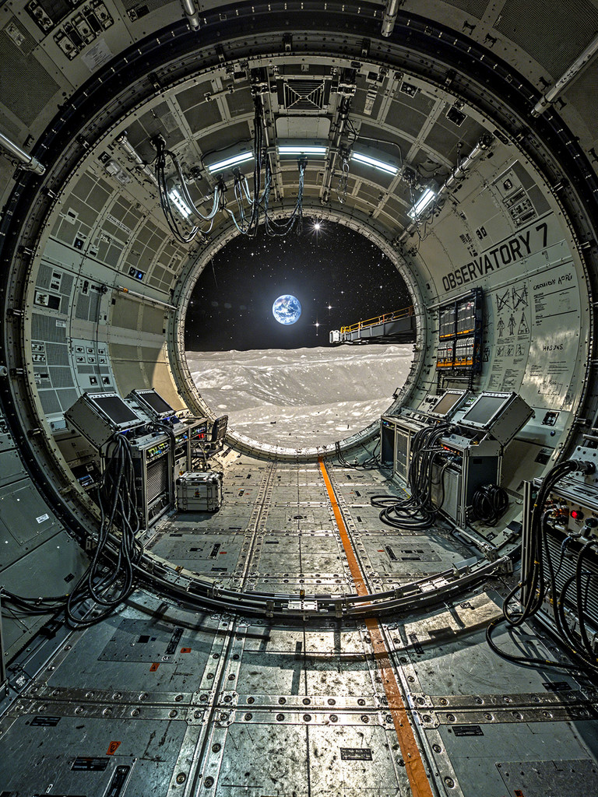

# HaDeS MOSS v0.9.4 Turbo — BF16

> **Newer version:** [HaDeS MOSS v1.0 Turbo](https://huggingface.co/DeVilDoNia/HaDeS-MOSS-v1.0-Turbo) (Base + Turbo v1.0, about 1 East Asian face in 16 on the neutral café prompt against 9-11 here). This file stays available.

A single-file, eight-step MOSS-Image text-to-image checkpoint for ComfyUI. It starts from [MOSS-Image-Base](https://huggingface.co/OpenMOSS-Team/MOSS-Image-Base), with three LoRAs baked into the diffusion weights. It offers a different rendering choice from MOSS-Image-SFT; the comparisons below do not show that either model is better for every prompt. **No separate Turbo or other LoRA is needed to run this file.**

| Property | Value |
|---|---|
| File | `HaDeS_MOSS_v0.9.4_Turbo.safetensors` |
| Format | ComfyUI MOSS-Image diffusion model, single-file safetensors |
| Precision | BF16; 10.16 GB (9.47 GiB) |
| SHA-256 | `32c215fc08ee8ec0e55459507e0712936adccf5804e94b6a7264bc33efd68770` |
| Base checkpoint | MOSS-Image-Base, not MOSS-Image-SFT |
| Author | HaDeS |

This is **only the diffusion model**. It does not contain the MOSS text encoder or VAE.

## Sample images

These are display-size JPEGs made from **BF16 v0.9.4** outputs in the eight-scene evaluation, not images from the SFT comparison arm. All six originals used the settings below at 1152 × 1536; the previews are resized to 768 × 1024. Seeds and source/preview checksums are in [`assets/manifest.json`](assets/manifest.json). These examples show individual outcomes, not a measured success rate.

| Watchmaker · seed 2401 | Climber · seed 2403 | Flower seller · seed 2404 |
|---|---|---|
|  |  |  |

| Rainy alley · seed 2406 | Citrus still life · seed 2407 | Lunar observatory · seed 2408 |
|---|---|---|
|  |  |  |

## Use in ComfyUI

1. Put the `.safetensors` file in `ComfyUI/models/diffusion_models/` and select it in a MOSS-compatible loader. The measured workflow used the [HaDeS MOSS Suite](https://github.com/Devildonia/HaDeS-MOSS-Suite) `MOSS Loader`.
2. Load the MOSS-compatible `qwen3.5_9b_int8_convrot.safetensors` text encoder and `flux2-vae.safetensors` VAE. Both are available in [Comfy-Org/MOSS-Image](https://huggingface.co/Comfy-Org/MOSS-Image). These are the exact companion files used in the comparisons here.
3. Enter a text-to-image prompt, create an empty latent, sample, then decode with the VAE. If using the Suite, set `MOSS Prompt Enhancer` to **as written**, connect `MOSS Latent` and `MOSS KSampler`, and use these starting settings:

| Setting | Measured reference |
|---|---|
| Size | 1152 × 1536 |
| Steps | 8 |
| CFG | 1.0 |
| Sampler / scheduler | Euler / simple |
| Flow shift | 5 |
| Denoise | 1.0 |
| Skip-layer guidance | Off |

Leave the KSampler's separate `turbo` LoRA input unconnected: its Turbo weights are already in this checkpoint. These settings were exercised on ComfyUI 0.43.0. Other resolutions may work, but the comparisons below used 1152 × 1536.

CFG 1 is the reproducible starting point, not a universal aesthetic optimum. In a paired four-scene, two-seed screen, raising CFG from 1 to 2 at eight steps increased saturation and near-clipped pixels, darkened all eight images, and took about 1.8 times as long in that session. The author preferred stronger CFG on some images (8 / CFG 2 on 3 of 8 sheets). Increasing steps also changed compositions; it was not a consistent quality improvement.

### Other step counts and CFG

Measured on eight scenes, one seed each ([measurement log](https://github.com/Devildonia/HaDeS-MOSS-Suite/blob/main/tools/RESULTS.md)): no image broke or burned from **6 to 50 steps** at CFG 1, nor up to **CFG 3** at 20 steps. More steps add texture and fine detail and take longer (about 4 s at 8 steps, 9.5 s at 20 and 23 s at 50 on an RTX 5090 at 1152 × 1536), but the image does not settle: each step count gives a different image of the same scene, so pick the count you like rather than expecting more steps to refine the 8-step one. In one scene a short sign was only right from 12 steps. Higher CFG darkens and saturates the image and doubles the time per step.

### Known bias

Asked for "a woman sitting in a café" with no ethnicity, 16 seeds at 8 steps gave about **9-11 of 16 East Asian faces** (counted by eye), against about 2-4 for MOSS-Image-Base at 25 steps. The Turbo LoRA baked into this model carries that bias. Name the person's appearance in the prompt when it matters: MOSS-Image-SFT and Base followed an explicit ethnicity in every test of the measurement log (not yet checked on this model).

## Construction

The author's saved workflow has this active path: **MOSS-Image-Base BF16 → MOSS Multi-LoRA → MOSS Model Saver**. The LoRAs were applied in this order:

| LoRA | Strength | Notes |
|---|---:|---|
| `data_expanded.safetensors` | 0.30 | Expanded-dataset LoRA described by the author as trained with MOSS-Image-SFT, then applied here to Base. |
| `HaDeS_MOSS_color_detailer_v0.2.safetensors` | 0.60 | A merged color/detail LoRA. Its file metadata names `HaDeS_test_colour_v01.safetensors` and `moss_context_detaile_tweaker_20261018_rank2.safetensors`, combined at inner weights 0.6 and 0.75. The table's 0.60 is the separate outer application strength. |
| `HaDeS-MOSS-BeTa-Turbo-8steps-v0.9.safetensors` | 1.00 | The author's unreleased Turbo v0.9 LoRA, baked into the checkpoint. The LoRA header says `steps: 4`, while this checkpoint was evaluated at eight inference steps. |

The model was saved as BF16 with nearest rounding. Its safetensors header identifies MOSS-Image architecture and 42 layers, but **does not embed the recipe**; this section records the author's workflow and the component-file metadata. The standalone LoRAs are not required for inference. No claim is made here that the recipe alone will reproduce a bit-identical file from different software versions or source files.

## Evaluation and limits

The [measurement log](https://github.com/Devildonia/HaDeS-MOSS-Suite/blob/main/tools/RESULTS.md) records exact prompts, seeds, settings, image metrics and the author's blind votes. Comparisons used identical prompt text, seed, 1152 × 1536 size, 8 steps, CFG 1, Euler/simple, flow shift 5, text encoder and VAE within each image pair. The compared pipelines differed in their model weights and LoRA application; these tests do not isolate the contribution of any one baked LoRA.

| Comparison | Images | Author's blind preference for v0.9.4 |
|---|---:|---|
| Against SFT + private Turbo v0.9, eight new prompts fixed before rendering | 8 pairs | 5/8 |
| Against SFT + released [Turbo v0.7](https://huggingface.co/DeVilDoNia/HaDeS-MOSS-Turbo), same eight prompts and seeds | 8 pairs | 6/8 |

One reviewer, one seed per prompt; the second comparison reused familiar images from the first, so it was only partially blind. AI-model reviews of the same sheets are logged separately as qualitative impressions and are not counted here. The author found v0.9.4 publishable as an **alternative** to SFT, and the results support that practical description. They do not establish general superiority, long-run consistency or a model-wide defect rate. In the eight new pairs, v0.9.4 had higher measured mean HSV saturation in every pair and more near-clipped pixels in seven; those numbers describe appearance, not image quality. Hands, small text and physical structure still deserve inspection in individual outputs.

The comparisons used **this BF16 file**. They do not validate the visual equivalence of the separately saved int8 ConvRot variant. The custom LoRA datasets and training details are not fully specified by the available model metadata; do not infer a training-data inventory from this card.

## Credits and license

Built on [OpenMOSS-Team/MOSS-Image-Base](https://huggingface.co/OpenMOSS-Team/MOSS-Image-Base), whose model weights are released under [Apache 2.0](https://huggingface.co/OpenMOSS-Team/MOSS-Image-Base/blob/main/LICENSE). This HaDeS checkpoint is also released under Apache 2.0. See the [MOSS-Image technical report](https://arxiv.org/abs/2610.23374) and the [HaDeS MOSS Suite](https://github.com/Devildonia/HaDeS-MOSS-Suite) for the upstream model and ComfyUI tooling.
