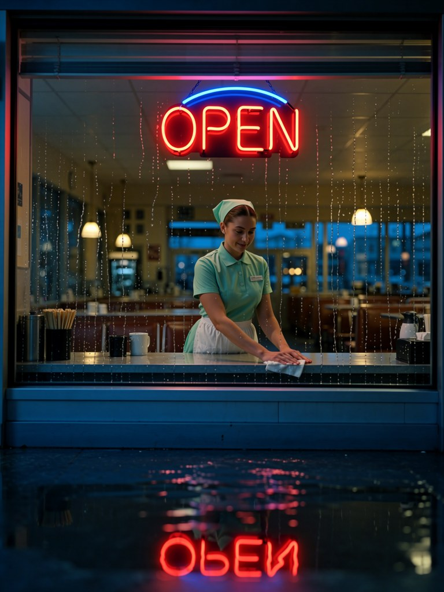
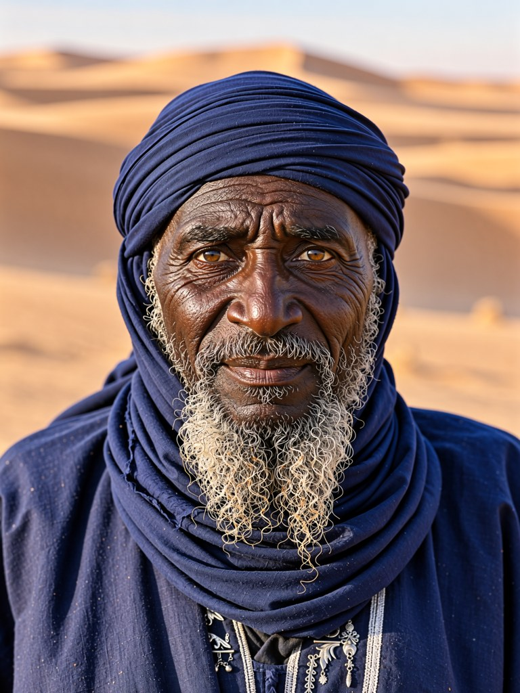
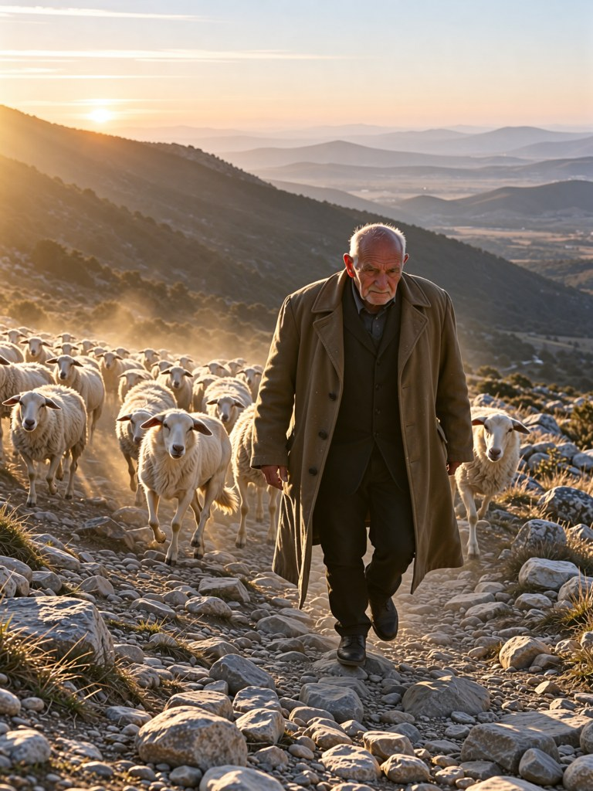
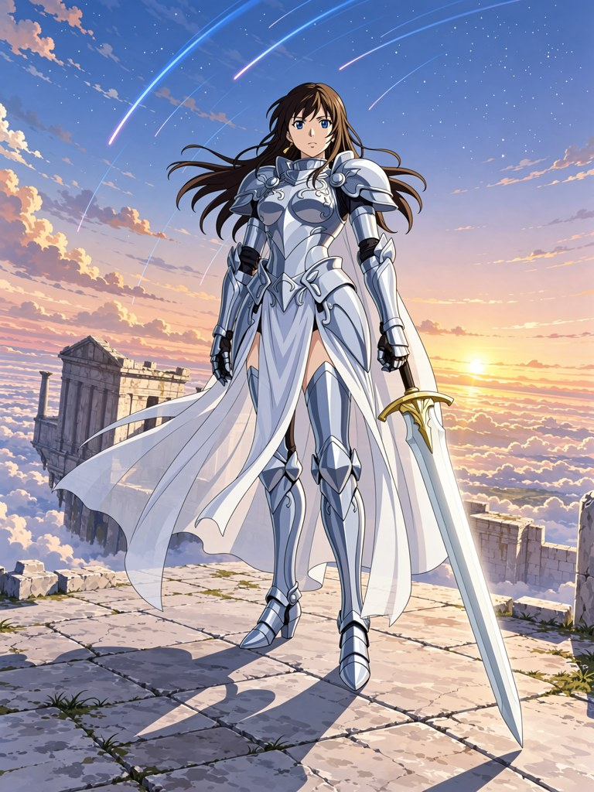
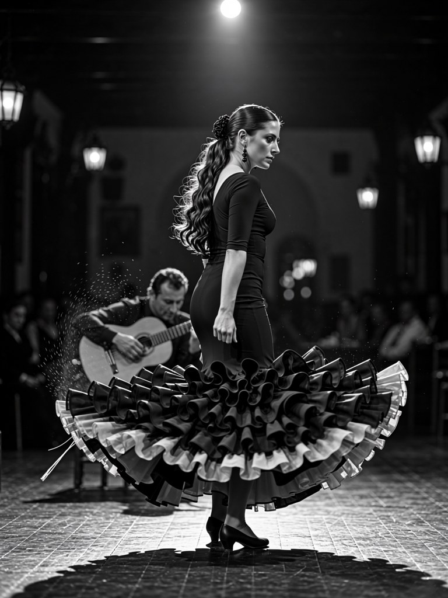

# HaDeS MOSS v1.0 Turbo — BF16

A single-file, eight-step MOSS-Image text-to-image checkpoint for ComfyUI. It starts from [MOSS-Image-Base](https://huggingface.co/OpenMOSS-Team/MOSS-Image-Base) with two LoRAs baked into the diffusion weights: the published [HaDeS MOSS Turbo 8-steps v1.0](https://huggingface.co/DeVilDoNia/HaDeS-MOSS-Turbo) and the author's QwenLook LoRA. **No separate Turbo or other LoRA is needed to run this file.** It follows [HaDeS MOSS v0.9.4 Turbo](https://huggingface.co/DeVilDoNia/HaDeS-MOSS-v0.9.4-Turbo), which stays available.

| Property | Value |
|---|---|
| File | `HaDeS_MOSS_v1.0_Turbo.safetensors` |
| Format | ComfyUI MOSS-Image diffusion model, single-file safetensors |
| Precision | BF16; 10.16 GB (9.47 GiB) |
| SHA-256 | `cfd7e0db798616954112604d28bcc55bf1adf56851d07f112fc786876c541e9e` |
| Base checkpoint | MOSS-Image-Base, not MOSS-Image-SFT |
| Author | HaDeS |

This is **only the diffusion model**. It does not contain the MOSS text encoder or VAE.

## Sample images

Display-size JPEGs (768 × 1024) of the author's outputs at 1344 × 1792, seed 1001, with the settings below. The prompts are long, detailed descriptions written with the `detailed` mode of the [HaDeS MOSS Suite](https://github.com/Devildonia/HaDeS-MOSS-Suite) Prompt Enhancer; the full prompts, settings and checksums are in [`assets/manifest.json`](assets/manifest.json). They were rendered with the release candidate of this file, which has the same weights (a re-render with the released file was pixel-identical). These examples show individual outcomes, not a measured success rate.

| Diner at blue hour | Elder in the desert | Shepherd at dawn |
|---|---|---|
|  |  |  |

| Travel poster | Anime key visual | Flamenco |
|---|---|---|
|  |  |  |

## Use in ComfyUI

1. Put the `.safetensors` file in `ComfyUI/models/diffusion_models/` and load it with **Load Diffusion Model** (or the Suite's `MOSS Loader`).
2. Load the `qwen3.5_9b_int8_convrot.safetensors` text encoder (Load CLIP, type `moss_image`) and the `flux2-vae.safetensors` VAE from [Comfy-Org/MOSS-Image](https://huggingface.co/Comfy-Org/MOSS-Image). These are the companion files used in every test below.
3. Sample from an empty latent with these settings:

| Setting | Tested reference |
|---|---|
| Size | 1344 × 1792 |
| Steps | 8 |
| CFG | 1.0 |
| Sampler / scheduler | Euler / simple |
| Flow shift | 5 |
| Skip-layer guidance | Off |

Leave any separate Turbo LoRA off: it is already in this checkpoint. Every test on this card used these settings. **Not measured on this model:** other step counts, CFG above 1, other sizes. The author's impressions, not measured: it looks best above about 1.5 MP, and CFG 1.2-1.5 can suit it.

## Construction

**MOSS-Image-Base BF16 → LoRAs below → MOSS Model Saver** (BF16, stochastic rounding). The recipe is written in the file header (`hades/recipe`).

| LoRA | Strength | Notes |
|---|---:|---|
| [HaDeS MOSS Turbo 8-steps v1.0](https://huggingface.co/DeVilDoNia/HaDeS-MOSS-Turbo) | 1.00 | The author's published eight-step DMD LoRA, trained on Base. |
| QwenLook Base | 1.00 | The author's text-to-image LoRA, not published separately: rank 32, 1000 steps at 1024 px, on 1833 images made by Qwen-Image-Edit 2509 (with the Qwen-Image-Lightning LoRA) from MOSS-Image-SFT scenes, each captioned with its scene prompt. |

Against the same two LoRAs applied live in ComfyUI (20 prompts, same seeds), the baked file gives the same compositions and the same sharpness (mean Laplacian variance 77.7 against 77.1); small details can differ, from rounding amplified by the eight steps (in one image a pistol in a hand was gone).

## Evaluation and limits

**Against v0.9.4 Turbo:** 20 new prompts (photographs, text on a chalkboard and an infographic, manga, pixel art, claymation, ink wash, cyberpunk, a children's book), one seed each, 8 steps, CFG 1, 1344 × 1792, shown in pairs with left / right at random. The author preferred **v1.0 in 16 of 20 pairs** and v0.9.4 in 4. One reviewer, one seed per prompt: this shows a preference on these prompts, not general superiority. An AI review of the same pairs is logged separately and not counted here.

**What the QwenLook LoRA changes** (Base + Turbo v1.0 with and without it, 16 photograph and 4 illustration prompts, one seed each):
- Sharper: the Laplacian variance roughly doubles (39 → 77 on the photographs, 114 → 271 on the illustrations) and the high-frequency share of the image goes from 1.9 % to 3.7 %, in every one of the 20 pairs.
- A cleaner, more polished look. Asked "is this a real photograph taken with a camera?", Qwen3.5-9B answered yes for 15 of 16 photographs without the LoRA and for 2 of 16 with it; the illustrations stayed illustrations (0 of 4 either way). One automatic judge, not calibrated on real photographs; the author's own view differs and finds the LoRA more realistic. If you want a rougher, more photographic look, describe the camera and the light in the prompt.

**Known bias:** asked for "photograph of a woman sitting in a café" with no ethnicity, 16 seeds at 8 steps gave about 1 East Asian face in 16 (counted by eye), against about 9-11 for v0.9.4. The 16 women look much alike, though: young, long wavy brown hair, smiling at the camera. Describe the person when it matters.

Hands, small text and crowded scenes still deserve a look in individual outputs.

## Credits and license

Built on [OpenMOSS-Team/MOSS-Image-Base](https://huggingface.co/OpenMOSS-Team/MOSS-Image-Base), released under [Apache 2.0](https://huggingface.co/OpenMOSS-Team/MOSS-Image-Base/blob/main/LICENSE). The QwenLook training images were made with [Qwen/Qwen-Image-Edit-2509](https://huggingface.co/Qwen/Qwen-Image-Edit-2509) and [lightx2v/Qwen-Image-Lightning](https://huggingface.co/lightx2v/Qwen-Image-Lightning), both Apache 2.0. This checkpoint is released under Apache 2.0. ComfyUI tooling: [HaDeS MOSS Suite](https://github.com/Devildonia/HaDeS-MOSS-Suite).
